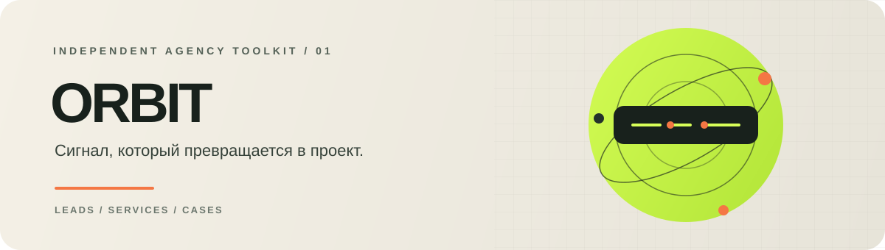
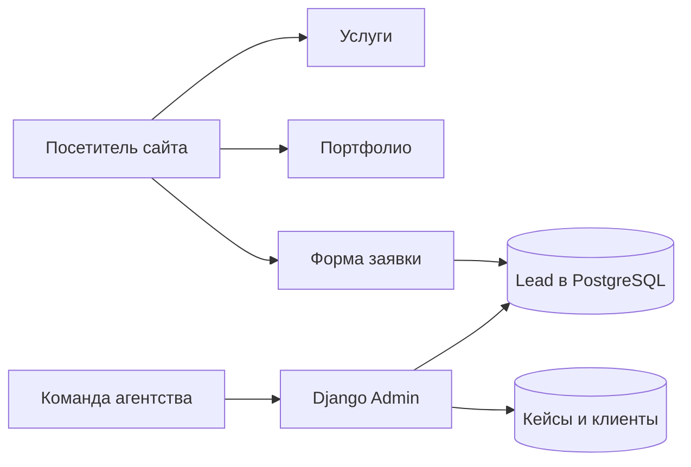

<div align="center">
  
  <br>
  
  
  
  
  <p><strong>От первого касания до кейса в портфолио — один API.</strong></p>
</div>

ORBIT — API для сайта маркетингового агентства. Он объединяет каталог услуг, опубликованные работы, список клиентов, социальные ссылки и входящие лиды.

## Поток проекта



## API-карта

Все маршруты данных находятся под `/api/v1/`.

| Метод | Путь | Назначение |
|---|---|---|
| `GET`, `POST` | `/api/v1/services/` | Просмотр и создание услуг |
| `GET`, `POST` | `/api/v1/portfolio/` | Просмотр и создание проектов |
| `GET` | `/api/v1/clients/` | Активные клиенты в заданном порядке |
| `GET` | `/api/v1/social-links/` | Активные ссылки на Instagram и Telegram |
| `POST` | `/api/v1/leads/create/` | Отправить имя, телефон и сообщение |
| `GET` | `/` | Главная страница агентства |
| `GET` | `/admin/` | Администрирование контента и заявок |

## Контентная модель

```text
Service ───────────── каталог услуг и цена
Portfolio ─────────── кейс, изображение и ссылка
Client ────────────── логотип, сайт и порядок показа
SocialLink ────────── Instagram / Telegram
Lead ──────────────── контакт и статус обработки
```

## Запуск

```bash
pip install -r requirements.txt
docker compose up --build
```

После запуска примените миграции:

```bash
docker compose exec web python manage.py migrate
```

API работает на `http://localhost:8000`, административная панель — на `/admin/`. Docker Compose поднимает веб-сервис и PostgreSQL.

## Технологии

`Python` · `Django` · `Django REST Framework` · `PostgreSQL` · `Docker Compose` · `WhiteNoise`
